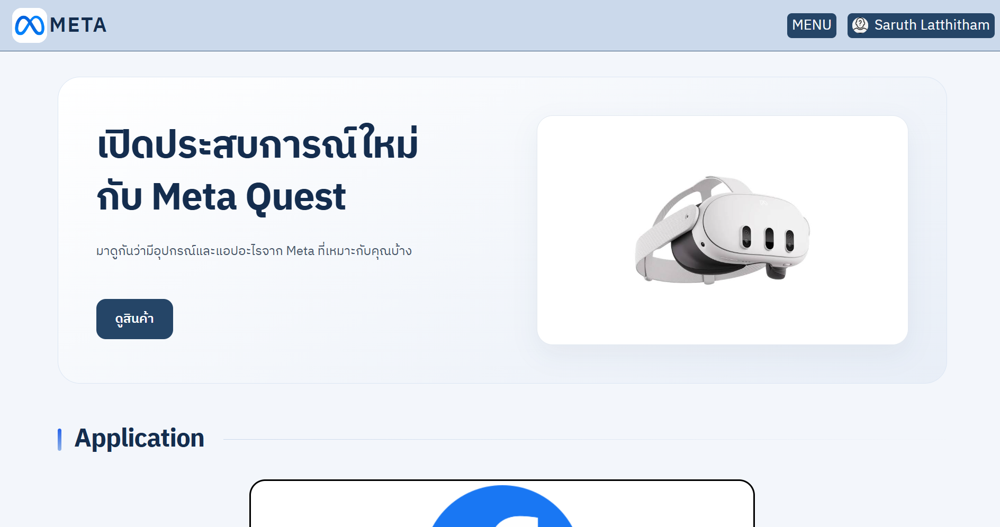
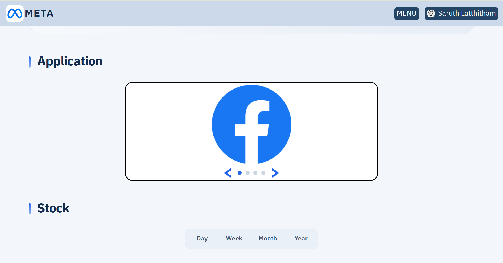
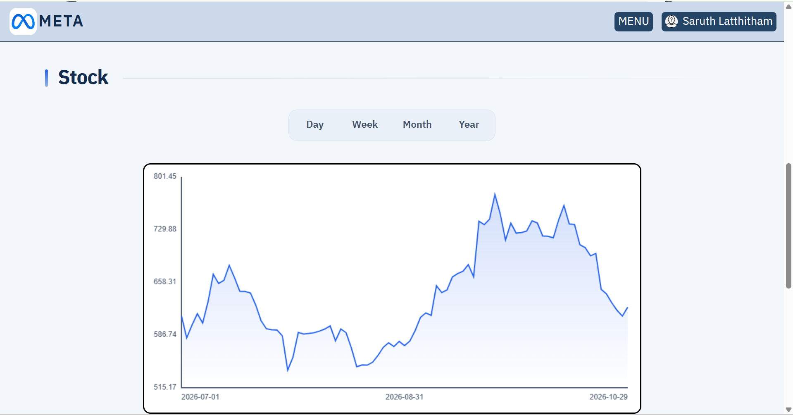
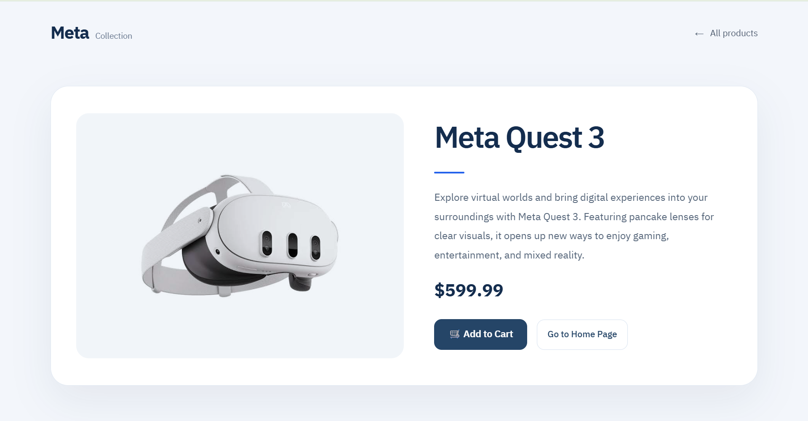
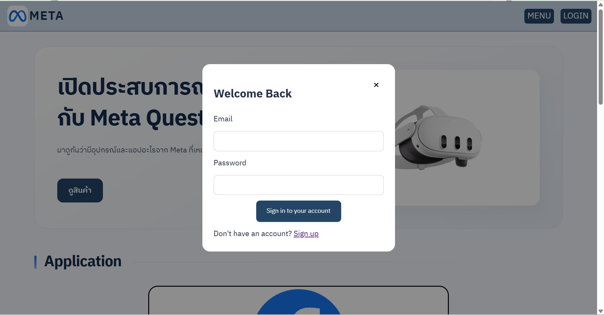
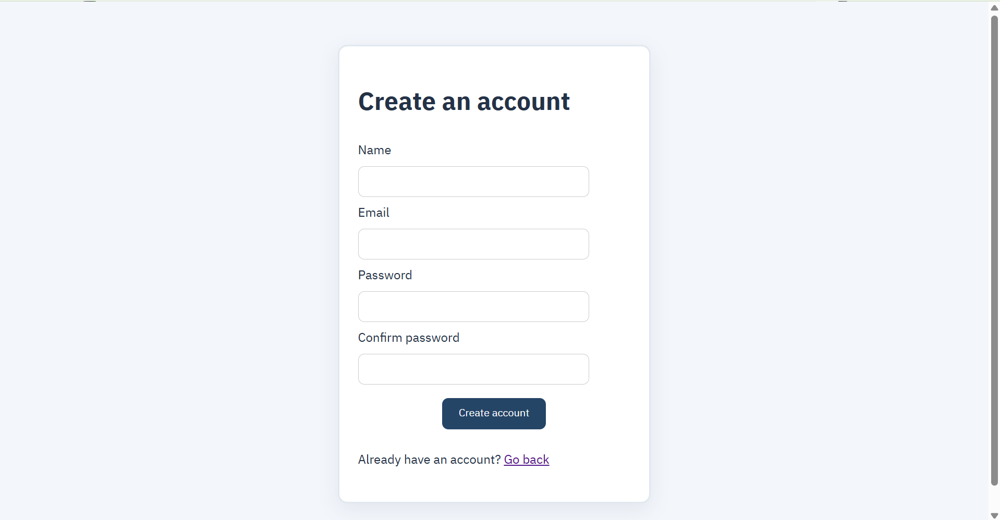
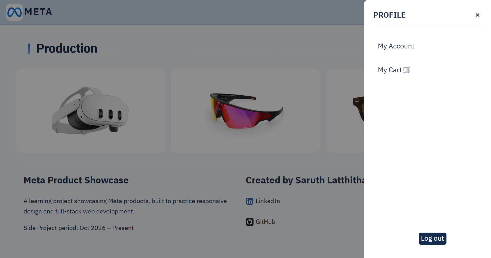

# Meta Product Showcase

A full-stack project for exploring Meta products and apps, built with TypeScript, Express, and MySQL.

## Features

- Browse Meta apps and products, with a details page for each product.
- View the META stock chart and choose a time range.
- Sign up, log in, and log out.
- View and update your profile.
- Add products to your cart after logging in and view the total.
- Use the site on desktop or mobile.

Stock data comes from Twelve Data.

## Screenshots

### Home



### Meta apps



### META stock



### Product details



### Account







### Cart

If you are not logged in, adding a product opens a prompt to log in.


## Framework and libraries

HTML, CSS, TypeScript, Node.js, Express, MySQL, mysql2, Argon2, and express-session. The stock chart uses the Twelve Data API.

## Getting started

You need Node.js with `process.loadEnvFile` support (such as Node.js 22 or later), npm, and a running MySQL server.

1. Install dependencies:

   ```bash
   npm install
   ```

2. Create the database and table in MySQL:

   ```sql
   CREATE DATABASE IF NOT EXISTS meta_app CHARACTER SET utf8mb4;
   USE meta_app;

   CREATE TABLE IF NOT EXISTS users (
       id BIGINT UNSIGNED NOT NULL AUTO_INCREMENT PRIMARY KEY,
       name VARCHAR(100) NOT NULL,
       email VARCHAR(254) NOT NULL UNIQUE,
       password_hash VARCHAR(255) NOT NULL,
       created_at TIMESTAMP NOT NULL DEFAULT CURRENT_TIMESTAMP
   );
   ```

3. Create a `.env` file in the project root:

   ```dotenv
   DB_HOST=localhost
   DB_PORT=3306
   DB_USER=your_mysql_user
   DB_PASSWORD=your_mysql_password
   DB_NAME=meta_app
   SESSION_SECRET=replace_with_a_long_random_secret
   ```

   Keep `.env` and your passwords out of Git.

4. Build and start the server:

   ```bash
   npm run build
   node dir/server.js
   ```

5. Open [http://localhost:3000](http://localhost:3000). Keep the server terminal open and press `Ctrl + C` to stop it.

Open the site through the server to use the account features.
